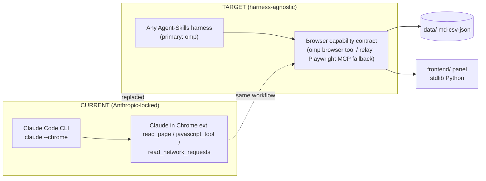

# MIGRATION PLAN — De-Claude: harness-agnostic architecture (omp primary)

**Status:** DRAFT — no runtime changes yet. Decision + step inventory only.
**Branch:** `feat/harness-agnostic-migration` · **Date:** 2026-08-26
**Decision inputs:** [`research/2026-08-26-agent-stack-alternatives.md`](research/2026-08-26-agent-stack-alternatives.md) · [`research/2026-08-26-recruiting-software-market.md`](research/2026-08-26-recruiting-software-market.md)

---

## 1. Decision record

**Problem.** CVSender is hard-coupled to two Anthropic products: Claude Code
(harness + skill invocation) and the "Claude in Chrome" extension
(`claude --chrome`; vendor tools `ToolSearch`, `read_page`, `find`,
`javascript_tool`, `read_network_requests`). The data layer (`data/`) and
dashboard (`frontend/`) are already vendor-neutral.

**Chosen architecture — harness-agnostic core, omp as primary harness:**

1. **Skill lives in the open-standard location** `.agents/skills/cvskill/`
   (Agent Skills spec, agentskills.io). omp discovers project `.agents/skills/`
   natively (its canonical `agents` provider) and registers `/skill:cvskill`;
   Codex CLI and OpenCode scan the same path — the skill stays portable to
   them with zero copies.
2. **SKILL.md references browser *capabilities*, never tool names.** Per-stack
   tool bindings live in one appendix table (§3). This is the actual
   de-coupling mechanism.
3. **Browser layer on omp = the native `browser` tool in OMP Browser Relay
   mode** — drives the user's real, logged-in Chrome via an MV3 extension
   (`omp browser-relay install`), same operational model as Claude-in-Chrome.
   Playwright MCP remains a documented fallback (runs under any MCP client,
   incl. omp via MCP config).
4. **Unchanged:** `data/` (md/csv/json), `frontend/server.py` + panel, the
   human-approval gate (policy v1), all 13 hard rules, per-board lessons.

**Explicitly rejected:**

| Option | Why rejected |
|---|---|
| OpenCode as primary harness | Research-recommended lowest friction, but user doesn't use it. Remains a **drop-in alternative** — same `.agents/skills` path works there unchanged. |
| Codex CLI as primary | Same portability argument; OpenAI-centric defaults. Drop-in alternative. |
| Gemini CLI | Consumer tiers sunset 2026-06-18; Antigravity CLI too young, Google-locked. |
| Aider | No skills/MCP/slash-command files; maintenance-mode signals since Aug 2025. Would force a full rewrite. |
| OpenAI Atlas / ChatGPT agent | Atlas dead 2026-08-09; ChatGPT agent is per-task supervised, no standing queue/CSV pipeline. |
| Framework rewrite (LangGraph & co.) | Unnecessary — the prompt-file architecture *is* the asset; the lock-in is only in tool vocabulary. |
| Commercial auto-apply SaaS | Zero coverage of JustJoin/Pracuj/NoFluffJobs/TheProtocol/Bulldogjob (see market research). |

**Why this is harness-agnostic, not omp-agnostic-to-Claude swap:** the only
omp-specific artifacts are (a) one row in the bindings appendix and (b) the
README's install hint. Everything else — skill format, location, capability
contract, data files — is standard or vendor-neutral. Switching primary
harness later = pointing a different CLI at the same repo.

---

## 2. Current vs target

Side benefit of the move: today `cvskill/SKILL.md` sits in `cvskill/` where no
harness discovers it (SESSION_STATUS notes `/cvskill` "not registered as a
skill, workflow executed manually"). `.agents/skills/cvskill/` fixes discovery
and gives a real `/skill:cvskill` command.

---

## 3. Browser capability contract (the core de-coupling)

SKILL.md hard rules and workflow text reference **only the left column**. The
bindings live in one appendix inside SKILL.md:

| Capability (what SKILL.md says) | omp `browser` tool (primary) | Playwright MCP (fallback) | Claude-in-Chrome (legacy) |
|---|---|---|---|
| navigate | `tab.goto(url)` | `browser_navigate` | navigate |
| click | `tab.click("eN")` / CSS | `browser_click` | click |
| fill text / select option | `tab.fill` / `tab.select` | `browser_fill`/`browser_select_option` | type/select |
| page structure (a11y refs) | `tab.observe()` / `tab.ariaSnapshot()` — `[ref=eN]`, shadow-root aware | `browser_snapshot` | `read_page` / `find` |
| JS in page context (shadow-DOM upload, DataTransfer) | browser `run` code: `tab.evaluate(...)` or raw puppeteer `page` | `browser_evaluate` | `javascript_tool` |
| direct file upload (input reachable in DOM) | `tab.uploadFile(selector, localPath)` | `browser_file_upload` | — |
| network inspection (submit verification) | `tab.waitForResponse(pattern)`; raw `page` request events (run-scoped) | `browser_network_requests` | `read_network_requests` |
| screenshot | `tab.screenshot()` | `browser_take_screenshot` | screenshot |
| skill invocation | `/skill:cvskill` | n/a (harness-level) | `/cvskill` |
| browser-control availability check | `browser` tool present in session | MCP server connected | ToolSearch |

**Rule-10 (shadow-DOM upload) rewrite sketch:** prefer direct file upload on
the input (path-based, no OS picker); if the input is hidden inside a closed
shadow DOM, run in-page JS: `fetch()` the CV from the local CORS endpoint
(`http://127.0.0.1:8765/api/cv-file`, unchanged in `frontend/server.py`) →
`Blob` → `File` → `DataTransfer` → set `input.files` on the shadow-DOM input
(walk `el.shadowRoot`) → dispatch `input`+`change`. Identical technique, new
envelope. The `/api/cv-file` endpoint stays.

---

## 4. omp wiring specifics (primary harness)

1. **Skill discovery:** project `.agents/skills/` is discovered after the
   project is trusted; toggle-independent `agents` provider (priority 70,
   below native `.omp` at 100). One-level layout only:
   `.agents/skills/cvskill/SKILL.md` ✔.
2. **Frontmatter:** keep `name: cvskill` + `description` (spec-required);
   Claude's `user-invocable: true` is preserved as unknown metadata — ignored
   by pi/omp, still meaningful for Claude Code if ever revisited.
3. **Browser Relay (recommended browser mode):**
   - one-time: `omp browser-relay install`, enable the extension in the
     isolated `CVSender` Chrome profile (the one already created during setup);
   - per session: `browser.relay` setting or `app.relay: true` on `open`;
     machine-global loopback relay auto-starts; extension handshake ≤35 s;
   - drives real logged-in tabs, no stealth injection, loopback-only with
     optional shared token. `app.target: "justjoin"` picks the tab by URL
     substring without stealing focus.
   - Fallback modes if relay is unavailable: spawn Chrome with
     `--remote-debugging-port` + persistent profile dir (`app.path`), or
     `browser.cdpUrl` attach to already-running CDP Chrome.
4. **Project context file:** add root `AGENTS.md` (currently none) that
   points to `SESSION_STATUS.md` as the bootstrap status file and to the
   skill — omp walks ancestors for `AGENTS.md`; Codex/OpenCode read the same
   file. This replaces README's "Claude reads SESSION_STATUS.md first".
5. **MCP fallback path (optional, for other harnesses):** Playwright MCP in
   `--extension` mode over the same Chrome; one entry in omp MCP config or
   `codex mcp add`. Not required for omp-native operation.

---

## 5. File-by-file change inventory

| # | File | Change |
|---|---|---|
| 1 | `.agents/skills/cvskill/SKILL.md` (new) | Move from `cvskill/SKILL.md`. Replace every vendor tool reference with capability names (§3); add "Tool bindings" appendix (§3 table); rewrite rule 10 per §3 sketch; keep the 13 hard rules, ATS lessons, per-platform notes otherwise verbatim. |
| 2 | `cvskill/` (old dir) | Delete after V1–V4 pass (no dual copies — the appendix's legacy column preserves the Claude path on paper). |
| 3 | `SETUP.md` | Step 0 rewrite: (a) harness check — any Agent-Skills harness, default omp; (b) browser check — relay extension connected or CDP/headless fallback; (c) same non-blocking behavior (rest of setup never needed the browser). Neutral wording throughout ("the agent", not "Claude"). |
| 4 | `SESSION_STATUS.md` | Neutral wording; replace `--chrome`/ToolSearch notes with relay/`browser`-tool equivalents; update "Następne kroki". |
| 5 | `README.md` | Wymagania: drop Claude Code + extension + `--chrome`; add: omp (or any harness with Agent Skills + browser automation), Chrome with relay extension, Python 3. Keep privacy section. |
| 6 | `AGENTS.md` (new) | Short bootstrap: read `SESSION_STATUS.md`; skill at `.agents/skills/cvskill/`, invoke `/skill:cvskill`; hard rules live in the skill. |
| 7 | `data/`, `frontend/`, `.gitignore` | **No changes.** |

---

## 6. Verification plan (gate before merging to main)

Each test = one real interaction on a high-value board, human approval before
any submit (policy v1 unchanged):

- **V1 Discovery:** fresh omp session in repo → `cvskill` appears in skill
  list; `/skill:cvskill` injects the workflow.
- **V2 Browser basics (relay):** ✅ **passed 2026-08-26** — relay (loopback 127.0.0.1:9224) attached to the CVSender Chrome profile; navigated JustJoin.it list → offer; `ariaSnapshot` returned Playwright YAML with `[ref=eN]` (58 KB); Apply clicked via `aria-ref` → new ATS tab (traits-analytics.com) opened and adopted via `app.target`; ATS form fully readable (field refs + submit). Lesson captured in the skill: JustJoin upsell modal's "Close modal" button times out on click — **Escape** dismisses it.
- **V3 Upload paths:** regular input → `tab.uploadFile(path)`; shadow-DOM
  (Traffit/SmartRecruiters) → DataTransfer via `run` JS; confirm attached CV.
- **V4 Submit verification:** `waitForResponse` on the ATS submit endpoint;
  ambiguous thank-you pages judged by network evidence, not page copy
  (existing lesson, new mechanism).
- **V5 Queue loop:** queue candidate → accept in panel → agent applies → row
  removed from `offerstosend.csv`, appended to `applications.csv` (rules 2/4).
- **V6 Dedup regression:** re-run a search pass; zero re-queued/re-applied
  candidates (rule 1); CSV quote-hygiene spot-check (rule 11).

Merge to `main` only after V1–V6. Rollback = stay on branch; nothing in
`data/` or `frontend/` is touched by the migration, so the old Claude path
keeps working from `main` throughout.

---

## 7. Risks & open questions

| Risk | Assessment / mitigation |
|---|---|
| LinkedIn UA §8.2.2 (eff. 2025-11-03) bans bots **and browser plugins** | The relay extension is the same tool class as Claude-in-Chrome — no worse, no better. Keep human gate + human-scale rates; consider LinkedIn manual-only (its logins were manual anyway). |
| Indeed ToS (2026-07-17) prohibits automating Indeed Apply | Same stance; prefer "Aplikacja w witrynie firmy" (employer ATS) paths, which the workflow already does. |
| Polish boards' ToS on automation — not audited | Open item: audit JustJoin/Pracuj/NoFluffJobs/TheProtocol/Bulldogjob ToS before heavy use. Market research §4 has the two verified clauses. |
| omp/pi bus factor (small community) | Mitigated structurally: skill is standard `.agents/skills`; Codex/OpenCode run it with the appendix's binding column swapped. |
| Relay drives the visible tab | `app.target` substring matching adopts a background tab without focus; use the dedicated `CVSender` Chrome profile so contention is with itself only. |
| Invocation name differs per harness (`/skill:cvskill` vs `$cvskill` vs `/cvskill`) | Documented in the bindings appendix; README names the omp form. |
| run-scoped request interception in omp browser tool | Network verification must happen inside one `run` cell (`waitForResponse`) — minor workflow constraint vs Claude's post-hoc `read_network_requests`; noted in the appendix. |

---

## 8. Rollout order

1. Land this plan + research reports (this branch) — **done with this commit**.
2. Implement §5 items 1, 6 (skill move + AGENTS.md) — **done**: `.agents/skills/cvskill/SKILL.md` (capability contract + bindings appendix, rule 10 rewritten), `AGENTS.md` added; legacy `cvskill/` kept until step 5.
3. Implement §5 items 3–5 (docs de-Claude) — **done**: `SETUP.md` + `README.md` rewritten and committed; `SESSION_STATUS.md` reworded in the working tree (left uncommitted — its diff entangles with the user's pending personal-data changes; commit separately once decided).
4. Run V1–V6 on the branch.
5. Delete `cvskill/` legacy dir; merge to `main`; update SESSION_STATUS.
